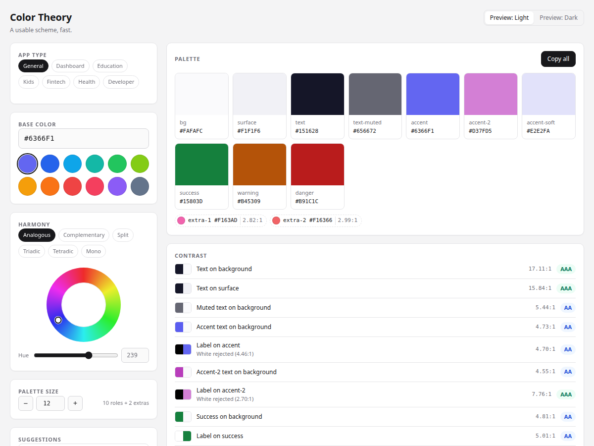

# Color Theory



A small, static tool for turning one color — or one harmony rule — into a
copyable, contrast-checked UI palette.

## Open it

Live: <https://paul-chukwuemeka.github.io/color-theory/>

Or run it locally:

```bash
# Option 1: open the file directly
xdg-open index.html

# Option 2: serve it, so the shareable URL works
python3 -m http.server 8000
# then visit http://localhost:8000
```

No install, no build step, no dependencies.

## Test

```bash
npm test
# or, with no npm:
node --test
```

The suite uses Node's built-in test runner and covers the color maths, the
palette invariants, the app types, the previews, the state/URL model, render
batching, and the accessibility floor.

## What it does

- Twelve named preset brand colors (Indigo, Blue, Sky, Teal, Green, Lime,
  Amber, Orange, Red, Rose, Violet, Slate) plus a custom hex field. HSL is the
  source of truth, so a hue you drag survives round-trips and grey bases.
- Seven app types: general, dashboard, education, kids, fintech, health,
  developer. A type shapes the neutrals, the accents, the semantic colors, the
  text contrast floor, and the harmony and theme the scheme opens in — without
  overwriting a harmony or theme you have already chosen.
- Six harmony rules: analogous, complementary, split-complementary, triadic,
  tetradic, monochromatic.
- A draggable hue ring and a hue slider.
- The base color is an input, not a role: the accent keeps its hue while the
  app type and the contrast floors reshape lightness and saturation, and the
  palette panel names the exact hex the accent ended up as.
- Ten color roles — `bg`, `surface`, `text`, `text-muted`, `accent`,
  `accent-2`, `accent-soft`, `success`, `warning`, `danger` — plus harmony
  extras and a matching `on-*` label color for every fill.
- Fill-safe accents: `accent`, `accent-2` and the semantic fills walk their
  lightness — never their hue — until they clear the 3:1 non-text floor on
  `surface`, then until their label clears 4.5:1. Text-safe twins
  (`accent-text`, `accent-2-text`) are stepped separately for use as text.
- `accent-2` is always at least 60° from `accent`, so the two stay distinct;
  monochromatic is the deliberate exception (a same-hue step).
- Semantic colors move away from the brand hue when they would sit too close,
  then keep their contrast floor.
- WCAG contrast ratios, truncated to two decimals, with AA / AAA / fail
  labels for text, accent text and every fill label.
- A palette size control: pick anywhere from 3 to 21 colors. Small palettes
  drop roles in priority order, larger ones add extra swatches.
- A live, finished-product preview per app type, with the states that belong to
  each screen built into the product UI instead of a debug row — see
  [The seven previews](#the-seven-previews). The preview is decorative for
  assistive tech, with a text summary alongside it.
- Copy any swatch, copy the whole palette, and export as hex, CSS custom
  properties, a Tailwind v4 `@theme` block, or JSON, for one theme or both.
  Every export leads with `base`, the brand color you typed, so it survives
  the reshaping the palette applies.
  “Both” CSS is three blocks: light, an explicit dark override, and an OS
  preference fallback that cannot beat a deliberate light choice.
- Shareable URLs: `?hex=&type=&harmony=&mode=&size=` is kept in sync and
  validated on load. Junk values are ignored, never trusted.
- A compact sticky swatch strip on small screens, and a sticky control rail on
  desktop.

## The seven previews

Each app type previews as a screen you might actually ship, with the states
that state belongs to built into the product UI rather than parked in a debug
row.

| App type | Preview |
| --- | --- |
| General | A marketing page with a live invite panel: focused field, field error, disabled button, and a status footer with an operational, a degraded and a failed service |
| Dashboard | An analytics workspace: KPI deltas, a revenue chart, a revenue-mix donut, and invoices in paid, pending and failed states |
| Education | A lesson in progress with the right answer, a wrong answer, the explanation, and a progress bar with a streak |
| Kids | A play session: the picked shape, a star count, lives left, and a step progress track |
| Fintech | A consumer bank: a balance card, a budget donut, quick actions, and cleared, pending and declined transactions |
| Health | A wellbeing dashboard: a readiness ring, sleep and step tiles, a week of heart rate, and a medication reminder |
| Developer | A failed deploy: the build log with the failing line, environment tags that are set, missing or invalid, and a stopped build |

Every screen paints every fill role, so a palette that drops a role shows what
the screen looks like without it.

## How the palette is built

1. **One hue in, HSL state out.** The base color is stored as `{h, s, l}`
   floats. Hex is derived for display and palette building, so dragging the
   hue ring never drifts and an achromatic base keeps the hue you moved to.
2. **Harmony.** The harmony rule supplies a partner hue and extra hues. The
   partner is clamped to at least 60° from the accent, so `accent-2` is always
   a second accent rather than a near-copy.
3. **App type.** The type shapes saturation and lightness, sets the neutral
   cast, picks the text contrast floor, and contributes the device-appropriate
   semantic colors for light and dark.
4. **Readable text.** `text` is walked from the background until it clears the
   floor on both `bg` and `surface`. `text-muted` is mixed toward the
   background, then walked back until it clears the same floor.
5. **Fills and labels.** A fill that matches the surface cannot be seen, so
   `accent`, `accent-2`, the semantic colors and the extras walk lightness
   until they clear 3:1 on `surface`. Light themes then deepen each filled
   role until a white label clears 4.5:1; dark themes lighten it until a
   near-black label does. Hue and saturation never move, mono extras step
   until every chip is distinct, and the preview reads the resulting `on-*`
   tokens directly.
6. **Extras and size.** Above the ten roles, extras fan out by hue, keeping
   the accent’s hue for monochromatic and walking outwards for the rest.
   Roles are dropped in priority order for small palettes.
7. **Contrast.** Ratios use the corrected sRGB luminance threshold
   (`0.04045`). Display truncates rather than rounds, so 4.496 never prints as
   “4.50” and pretends to pass.

## Cache busting

Every stylesheet and script is loaded with a `?v=N` query in `index.html`.
Bump that number whenever you change CSS or JS so browsers and the GitHub
Pages CDN fetch the new file instead of a cached copy.

## License

MIT — see [LICENSE](LICENSE).
